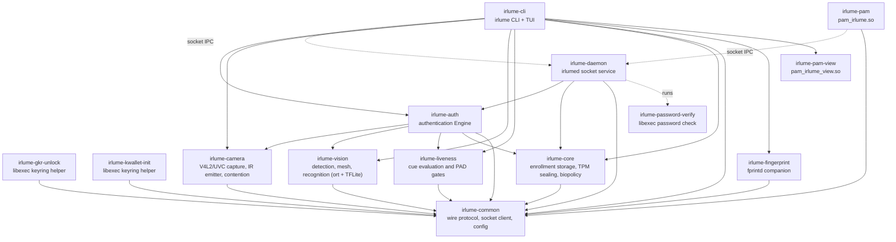

# The irlume crates

Fourteen crates. The base layer speaks wire formats and hardware, the
middle layer turns frames into verdicts, and the top layer is the two
binaries and four integration shims users actually run, plus a
password-check helper the daemon runs. Solid arrows
read "Cargo-depends on" (every edge verified against cargo metadata);
dotted arrows are runtime links (socket IPC, or a helper the daemon
runs), not Cargo dependencies.

## Responsibilities and stability boundaries

The Rust library APIs are internal. Compatibility applies to the wire,
storage, CLI and system interfaces the project documents, not to arbitrary
Rust symbols or unlisted commands.

| Crate | Responsibility | Boundary |
|---|---|---|
| `irlume-common` | Socket protocol and client, shared config and model catalog | Keep socket changes additive for mixed versions; no internal crate dependencies |
| `irlume-camera` | V4L2/UVC capture, device pinning, IR emitter and schedule qualification | Hardware and qualification contracts; no grant decisions |
| `irlume-vision` | Detection, alignment and inference, including the pinned TFLite mesh | Model loader contracts; no PAM or daemon dependency |
| `irlume-liveness` | Cross-spectrum cues and presentation-attack checks | Cue verdicts only; PAD cues can deny, not grant |
| `irlume-core` | Enrollment storage and matching, TPM sealing and recovery | On-disk formats and TPM policy; not a public Rust API |
| `irlume-auth` | Composes the pipeline and decides face authentication | Sole face grant decision; no socket or PAM handling |
| `irlume-daemon` | `irlumed`, peer authorization, socket, serialized engine work and watchdog | Privileged service and socket contract |
| `irlume-cli` | `irlume` commands, TUI, PAM wiring and machine API | Documented CLI and versioned machine API; [reference](../docs/reference/MACHINE-API.md) |
| `irlume-fingerprint` | fprintd adapter for fingerprint companion flows | Internal wrapper; the provider verifies fingerprints |
| `irlume-pam` | `pam_irlume.so`, thin daemon client in PAM | PAM ABI and password fallback |
| `irlume-pam-view` | `pam_irlume_view.so`, session-only LightDM view detach | PAM session ABI; no grant decisions or internal crate dependencies |
| `irlume-gkr-unlock` | Delivers a secret to the GNOME keyring | Private packaged helper, not a second socket client |
| `irlume-kwallet-init` | Delivers the wallet key to KDE's secrets service | Private packaged helper, not a second socket client |
| `irlume-password-verify` | Verifies the password for a retry reset through `/etc/pam.d/irlume-retry-reset` | Private daemon-to-helper contract; no internal crate dependencies |

## What the graph does and does not promise

- The graph shows normal Cargo dependencies. Daemon fixtures use
  **irlume-liveness** directly, but the daemon relies on **irlume-auth** for
  liveness in production.
- **irlume-auth** is the only crate that composes the pipeline into an
  AUTHENTICATION: a grant decision is born nowhere else. The CLI also
  Cargo-depends on the pipeline crates directly, for its diagnostics,
  benchmarks and model tools, so a change to any pipeline crate must be
  reviewed against the CLI's direct uses too, not only the Engine's.
- **irlume-common** depends on no other irlume crate, and every other
  crate except **irlume-password-verify** and **irlume-pam-view** (which
  depend on none) depends on it: the wire protocol has exactly one home.
- The pipeline crates meet only through data: **irlume-camera**,
  **irlume-vision**, **irlume-liveness** and **irlume-core** depend on
  no irlume crate but **irlume-common**, and **irlume-auth** (or the
  CLI, for its tools) passes values between them.
- The integration shims (**irlume-pam**, **irlume-pam-view**, the keyring
  helpers) stay thin, one system interface each (plus, for **irlume-pam**,
  the daemon socket, and for **irlume-gkr-unlock**, the user bus it only
  watches to learn when gnome-keyring is ready), so the attack surface
  loaded into PAM stacks and keyring startup is as small as it can be. The
  keyring helpers never talk to the daemon, and no binary links another
  binary's crate.

Each crate's own source carries the detailed contracts; start at
`irlume-auth/src/lib.rs` for the Engine's assess flow and
`irlume-daemon/src/main.rs` for the request surface.
