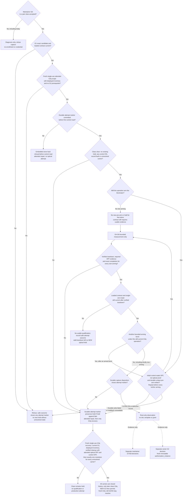
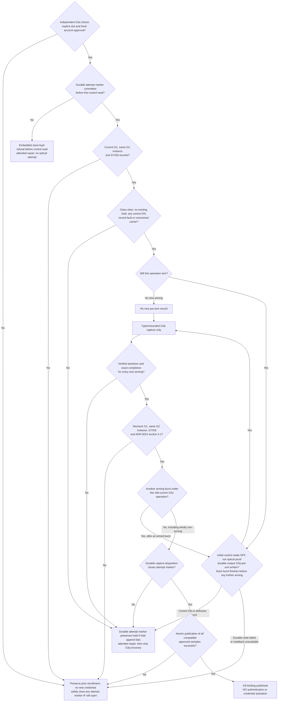
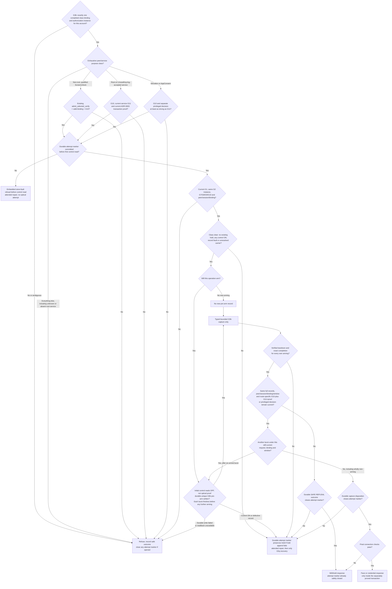

# ADR-0041: Embedded-IR capture is admitted before backend design

## Status

Proposed 2026-11-15 for #1379. Awaiting multiple rounds of architecture
review. Neither this proposal nor its acceptance authorizes backend, decoder,
diagnostic or other implementation.

Depends on ADR-0003 (keyring/session release), ADR-0004 (per-enrollment IR
calibration), ADR-0007 (capture qualification), ADR-0008 (privacy-bounded
diagnostics), ADR-0013 and ADR-0019 (PAD), ADR-0014 (admission posture),
ADR-0016 (IR-only evidence), ADR-0017 (authentication never changes
enrollment), ADR-0020 and ADR-0021 (paired capture), ADR-0023 (profile
boundaries), ADR-0024 (camera-scoped enrollment), ADR-0025 (one template-key
unseal), ADR-0027 (decision and teardown), ADR-0028 (strict IR-only pair
resolution), ADR-0029 (selection), ADR-0030 (scoped diagnostics), ADR-0031
(IR endpoints, exposure, active-IR provenance and access), and ADR-0032
(administrator pairing and experimental split-pair posture).

This ADR changes no current admission, capture, enrollment or credential
rule. It does not amend ADR-0027. Any future class that relaxes the current
RGB, PAD or credential guarantees needs its own approved decision and must
name its amendments explicitly.

The source examination used irlume `cf097b8decc138f008768ad01217fc398bb49346`.
Kernel and libcamera statements below distinguish source-derived restrictions
from unresolved hardware behavior. They do not qualify any physical unit.

## Context

An embedded MIPI sensor behind an Intel media graph is not a USB webcam. It
may share receiver, pipeline, media-control, sensor-control and illumination
resources with the colour sensors. Providing `/dev/videoN` output or routing
frames through v4l2loopback does not establish a production pair, graph
ownership, optical provenance, liveness or an authorized device identity.

Current IR-only operation resolves a configured capture pair whose two nodes
must each have USB identity. Secondary account bindings compare both sides
strictly; the legacy primary can contain an incomplete identity whose
corresponding side remains unchecked. `FaceScan.rgb` is a required RGB
embedding, and the IR-capable enrollment path requires RGB and IR PAD. A bare
`--sensor` label, populated RGB identity, successful visible image or
synthesised embedding cannot replace those contracts.

The current CIO2 source gives no graph-wide ownership mechanism. Its shared
DMA and `cur_queue` state do not establish supported simultaneous RGB and IR
capture. Device permissions, V4L2 priority and vb2 queue ownership cover
narrower problems, but do not exclude retained descriptors, every equal
priority client, subdevice/media control or libcamera's graph reset behavior.
These findings require a separate coherent capture contract, not a new
coordinator presented as an ownership lock.

The OV7251 v3 strobe series was unmerged when the review read it at
2026-11-15T20:09Z. A later `Tested-by`
on another device required local adaptations. Sensor, receiver, LED-control
and format contracts differ across devices. A DMI name, sensor name or a
product-family profile cannot select an emitter or authorize capture without
exact device evidence.

The prior proposed combination of exclusive IR-only authentication,
profile-based admission and a bespoke whole-graph coordinator is therefore
not selected. Deferring the difficult questions while building the easy
capture components would merely develop code with no authenticated consumer.

## Decision

### 1. Decide the admitted pair class before defining backend interfaces

The default for an embedded-IR candidate is **present but not admitted**. It
must not reach enrollment, face matching or credential release. Opt-in
read-and-refuse diagnosis produces non-biometric class and refusal facts, not
a pair or a capture capability.

The first required maintainer decision is which of these classes is desired:

| Candidate | Required coherent design before any backend API |
|---|---|
| Current ordinary RGB+IR contracts and opt-in experimental split pairs (ADR-0032) | Keep those paths and their rules unchanged. Do not reinterpret embedded nodes as existing UVC contracts or widen `ConnectedPair`/`SplitPair`. |
| Embedded RGB+IR pair | Real RGB capture and RGB/IR PAD evidence, exact non-USB role and pair binding, and compatible enrollment and calibration. A relationship for concurrent or sequential captures is proven for the exact contract. Missing RGB is not an IR-only configuration. Provenance, not frame skew, sets admission posture: without exact-contract concurrent qualification, it is sequential at any skew and only IR-identity-verified arms may grant (ADR-0014, ADR-0032 §5). On the reporter's Book 2 the colour sensors deliver raw Bayer requiring the ImgU/ISP and libcamera IPA; irlume has no equivalent RGB capture path. |
| Integrated IR-only authentication class | A separate accepted ADR defining RGB-less enrollment, the changed evidence model and migration. First prove that class on an already supported USB IR device. Preserve strict matching, explicit enrollment, PAD and a separate release hold. |
| No authenticated embedded-IR class | Read-and-refuse diagnosis only. A viewing bridge remains outside irlume and is never a credential input. |

This ADR deliberately does not select the second or third alternative. A
`cameras.d` flag, a compiled support contract, local administrator slot
authorization or a machine default cannot make that selection. No proposed
backend trait, frame schema or enrollment schema is stable until it is made.

### 2. Closed non-USB admission and typed operation authority

Current exclusion relies on capability checks and single-planar
inventory/capture behavior. `verify_pinned` accepts PCI paths, while
`device_identity` returns no identity for non-USB nodes. Ordinary legacy
binding checks treat absent identity sides as unchecked. Any future native
capture support must not make that incidental exclusion the security boundary.

Every identity, role-classification and binding decoder or non-USB capture
entry shared by `irlume-camera` and its consumers must enforce a
class-independent refusal, even in direct-capture CLIs, examples and
evaluators. No configuration, environment variable, Cargo feature or `cfg`
admits an ordinary physical non-USB capture, including the development
`test-support` feature and the `IRLUME_TEST_ALLOW_VIRTUAL_CAMERA` path.
Only crate-owned `#[cfg(test)]` fixtures model the new class's admission,
while daemon and auth tests may use non-capturing `test-support` mocks
supplied by mock-only paths in their test environment. No feature or setting
makes production non-USB admission constructible: that is a property of the
capture-boundary and decoder code, not of a caller opting into a test path.

This refusal is not a ban on the existing exact-path and loudly logged
virtual-camera exception or its v4l2loopback fixtures. Those existing CI and
mock/integration capabilities remain unchanged for their existing sources.
They are not a physical embedded-camera class, a sensor identity, RGB
enrollment evidence or an authority to authenticate or release a credential.
The future typed embedded capture handler verifies physical origin before it
constructs that operation's admission; it does not move or reinterpret the
existing `verify_pinned` virtual-camera early return or its exception for the
existing escape paths. Never widen the virtual-camera exception for this class.

**Default production refusal is not bypassed by a per-class flag.** After a
later class ADR, the capture-entry successor accepts only a typed,
single-operation admission built by the G3q, G3a or G3b handler from that
operation's own gates, exact class, loaded contract and intended purpose;
for G3q, its authority is the administrator's attended per-operation scope
record, which never satisfies G2. G3a and G3b additionally require the G2
slot's `authorization_instance`. These operation types are not convertible.
Qualification output cannot become a regular authenticated frame, locally
authorized slot or account binding merely by relabeling it. Enrollment and
authentication captures cannot inherit a short-lived qualification admission.
A default/missing arm still refuses before a stream opens.

For an embedded class, `Identify`/`IdentifyFor`, positioning, `AddScan`
outside G3a, `CaptureEarMedian`, `SelfTest`, `TuneCaptureMode`, background
requalification, `SetupIrEmitter`, open/readiness checks other than the
camera-free unsupported status, diagnostics and direct CLI/example capture
all refuse rather than borrow production admission. Existing ordinary USB
entries retain their behavior. The enrollment-candidate and pinned/standing
pair paths never implicitly choose an embedded slot, and completion of G3a
does not automatically select one or promote it to the standing pair.

The `camera_binding` **value itself** must carry a fully discriminated
embedded class which frozen ordinary, pre-split-primary, `PairBinding` and
secondary-store readers reject. An unknown JSON member is not a class tag:
legacy readers may ignore it and treat a missing `camera_binding` as unbound,
including an unchecked side. A new representation must fail completely,
never deserialize partially into `ConnectedPair`, `SplitPair`, an absent
binding or an ordinary binding with empty fields. Existing USB records and
their operations are unchanged. Immutable local authorization identity is a
versioned property of the local authorization record, not a claimed sensor
serial or USB identity; section 3 makes that distinction explicit.

### 3. Compose four independent authorities

The following conceptual records are design inputs, not new public APIs:

1. **Request posture** preserves current consent, privilege, account, seat,
   retry, deadline and one-worker constraints. A client supplies frames
   neither directly nor through a virtual device.
2. **Reviewed support contract** is compiled, reviewed code like the
   exact-device `known_control` table, not a `cameras.d` profile. It identifies
   exact candidate device/variant and loaded contract semantics: graph, roles,
   accepted formats, kernel and module/backport contract, dimensions, optical
   controls and teardown. It may reject candidates and open no emitter or
   stream. It grants no local permission and does not classify unknown nodes
   by name.
3. **Administrator-attended local slot authorization** identifies one
   qualified hardware/loaded-driver state on this machine under a versioned
   local slot record. That record has an immutable, machine-local
   `authorization_instance`, alongside its class and durable location.
   Re-authorizing a slot after removal, replacement or contract change
   creates a NEW immutable instance rather than extending the old one.
   Active account bindings and activation records pin this instance as well
   as the location. The previous binding stays inactive after its instance
   disappears or is superseded until a separate ADR-0024 §4 credential
   operation explicitly rebinds it. Re-authorization cannot silently restore
   an old template merely because the slot name and location match. Onset of
   an embedded optical/record hold is another mandatory retirement event:
   EVERY immutable instance of that class, in every local slot, is marked
   inactive in protected slot activation history together with the hold
   carrier, or the open attempt marker blocks the class until those
   retirements are committed and verified. Different slot locations cannot
   preserve a backdoor around a class-wide hold. Retired instances NEVER
   become current again. Pending retirement, open marker or unfulfilled
   retirement commitment blocks their use until every required retirement is
   recorded; committing that retirement cannot reactivate the old instance.

   Current graph, exact route, kernel/module and accepted-format and
   frame-boundary facts are revalidated before each enrollment or
   authentication capture. Duplicates, missing parts or ambiguity refuse.
   Mutable node numbers and entity IDs are observations against opened file
   descriptors, not durable identities. ADR-0007 qualification keys are
   USB-defined and cannot be reused or extended. Qualification's first
   measurement has its own initial rule in section 4; it does not require a
   finished optical qualification before that measurement exists.
4. **Account enrollment** selects the exact admitted pair and its
   camera-scoped templates before capture. Enrollment and credential changes
   retain their separate permissions. Administrator slot authorization
   neither enrolls an account nor selects a default camera. The account
   binding is a class-tagged key naming the slot's complete durable location
   AND immutable `authorization_instance` from machine-verifiable topology
   facts and privileged publication. A missing component cannot act as a
   wildcard (ADR-0032 §2). No node number, entity ID, DMI value, UUID or
   sensor serial becomes uniqueness evidence. The local instance identifier
   records one attended authorization decision, not unique hardware identity.

   Removing, moving or redefining a slot never rewrites, moves or reactivates
   an enrollment (ADR-0024 §1.1, ADR-0032 §4). Binding an account to a
   different key is its own credential operation (ADR-0024 §4). Slot
   authorization and qualification records are root-owned and published only
   by irlumed under the displayed-inventory guard of ADR-0032 §4. Enrollment
   never creates, extends or refreshes them. The records expose no serial,
   UUID, raw path, I2C/ACPI identifier, frame or embedding to non-root
   callers; their reported projections follow ADR-0008 and ADR-0030 §4.

   The ADR-0029 §3 enrollment-candidate rule, `NotApplicable` retention,
   ADR-0007 first-enrollment qualification and background requalification
   never select, retain, qualify or open an embedded slot. First enrollment
   requires an explicit operation naming an already-approved slot and fresh
   account credential-management approval, following the explicit-choice
   rule of ADR-0032. Authentication never feeds frames into enrollment.

Support contract, local slot and requested account must name the same typed
pair class. Authentication requires exactly one currently eligible binding;
zero or multiple matches refuse without using discovery or store order. The
embedded class is considered only through its own explicit class-tagged
binding and immutable authorization instance, not inserted into an older
ordered camera collection or auto-selected as a new standing pair. First
enrollment still requires its distinct G3a authority rather than a preexisting
binding. Ordinary primary/secondary selection stays unchanged, and no
biometric/PAD refusal moves an attempt to another camera.

An identical replacement sensor may be indistinguishable from the authorized
one. That residual risk must be explicit, as it is for serial-less USB
cameras and split pairs (ADR-0024 §6, ADR-0032 §2). Do not manufacture USB serials,
claim a globally unique physical identity from a graph, or replace an
admitted account binding with DMI, UUID, TPM or undocumented sensor data.

### 4. Separate prior authorization from capture operations

A third operation, **bounded attended qualification capture**, requires its
own explicit scope for a recognized candidate and its loaded contract. Its
strict, non-granting activation is consulted by no production admission
predicate; the G3q lane supplies its own scoped authority, never an implicit
bypass or a stream labeled as enrollment or authentication. The administrator
chooses the operation and accepts the scoped optical and RGB-availability
effects under ADR-0032 section 4's displayed-inventory guard. Each scope is
single-use for one bounded attended operation and cannot be replayed as
authority for a later campaign phase; every phase needs a fresh scope.
Section 9 specifies each lane's actual operation identity: G3a and G3b must
not borrow or claim G3q's attended scope. G3q may produce only root-owned
qualification results or campaign data under
the applicable protocol's consent and data rules. If real biometric material
is needed, that protocol separately defines consent, handling and disposal;
this ADR authorizes no recruitment or collection. Section 9 defines the
separate G3q recovery exception that may enter under a class hold; no other
capture operation may do so.

At activation it rechecks the G1 candidate facts and loaded contract, and
applies sections 6, 8, 9 and 10 to the operation under G3q. There is no initial
requirement for a completed unit qualification that this operation has not
yet produced. Instead, when optical OFF is required, the attended measurement
in this scope must establish it at the prescribed shutdown point. Without
that evidence no usable qualification result is produced and the class remains held for
attended recovery; a cached readback never substitutes for that observation.
An unknown ceiling or phase cannot be declared healthy merely because the
capture is labeled experimental.

This operation creates no slot authorization by itself, account binding,
template, per-account calibration or grant, and cannot publish an enrollment
or release a secret. Its temporary measurements cannot become a credential through a
label change. After its own verified teardown and loaded-contract check it
can supply inputs to the G2, G7 and G8 decisions, whose separate authorities
are still required. An enrollment credential operation or an authentication
request can proceed only under its subsequent separate G3a/G3b and purpose
requirements, not as a consequence of qualification or an attended login.
Each campaign phase repeats its scoped revalidation; production refusal stays
in force for every other input.

Three figures separate qualification/recovery, enrollment, and
authentication with its credential boundary. They share no capture
admission. Dotted edges in the qualification figure carry observations for
separate decisions, not frames, credentials or implicit permission. Prior
data is not current merely because it is drawn as a record. The arrows
describe responsibility and ordering, not literal RPC interfaces or newly
authorized operations.



**Separate enrollment credential operation:**



**Authentication and deferred secret release:**



An embedded candidate follows the no-accepted-class refusal in G0 today.
Loopback, dummy, synthetic frames and caller-supplied identity never become
a trusted sensor or pair. Root-only diagnosis produces share-safe refusal
facts, not a pair, template or authority (ADR-0008). Visual observation of a
graph is not permission to use a sensor. G10 purpose admission is the
exhaustive peer/service decision below, never a test that a service appears
unable to release later. The class and transaction hold covers the existing
class-blind session `UnsealKeyring`, but is enforced at the face request
before camera and at its final boundary. The `ondemand`/`facefirst`
identity-only fallback cannot bypass it.

Each operation's required current record checks occur within that operation's
own lane, and a refusal does not become authority by crossing a dotted record
edge. Enrollment publishes only compatible, explicitly authorized samples
under its transaction contract; a failed publication preserves the prior
state and grants nothing. Unsafe teardown publishes no samples and returns
no face or credential success, and holds the class pending attended recovery.
Authentication can deliver its face result or credential only following its
late purpose and identity checks and successful final connection checks;
failure at either boundary withholds the response. A refusal after verified
teardown does not by itself create an optical hold. None of these lanes
converts IR pixels into an authentication, enrollment or standalone
credential entitlement.

### 5. Preserve existing RGB, enrollment and credential boundaries

Until a later ADR explicitly replaces them, require the current complete RGB
and IR roles, RGB-based enrollment, modality-appropriate PAD, exact account
binding and revalidation before a grant. For an embedded candidate, never
record an RGB identity for an endpoint whose RGB evidence irlume did not
capture at enrollment. Never convert an IR frame or copy another embedding
into `FaceScan.rgb` to satisfy storage format requirements. The current
IR-only route, which holds the configured RGB identity for strict pair
resolution without opening its RGB endpoint (ADR-0028 §1), is unchanged.

RGB-less enrollment cannot be inferred from `Vec<f32>` deserialization or a
successful IR-facing recognizer experiment. Store version, legacy visibility,
downgrade behavior, key lifecycle, calibration, camera scope and account
revocation must be defined together before an integrated IR-only credential
class is considered. Existing templates cannot be silently reinterpreted as
belonging to this class. Per-enrollment IR calibration under ADR-0004 fits
toward the account's RGB anchor, so an RGB-less class lacks that calibration
basis until its replacement is designed and separately validated.

A proposed integrated IR-only mode remains experimental and has no automatic
credential privilege. It needs a new class-scoped release hold that current
code lacks: `face_tier` maps `IrOnlyExperimental` to `Secure`, permitting a
face-backed release on its first grant. The new class has no such mapping.
Its release hold persists after successful evaluation and lifts only at G11.
It must document which RGB and cross-spectrum assurance is absent and cannot
inherit ordinary RGB+IR support status.

That hold covers releases later in the same PAM transaction, without
another face match. ADR-0003's session-phase `UnsealKeyring` can release on
appropriate root-peer/service-class evidence and its other documented
prerequisites, without checking the login's face class. The
`ondemand`/`facefirst` fallback from a pre-camera `UnsealUnavailable` to
`Authenticate` does not exclude that path: `reseal` handling can release
even after only a verification result. There is no permission to assume
that inspecting a service name, a live-session result, or a PAM stack proves
that the transaction cannot later release.

Before that session-memory contract changes, `UnsealKeyring` stays
class-blind. The new class's hold is enforced at its face request, before
camera and again at its final boundary:

- A request from a **non-root peer** can use G10 alone only in the existing
  qualified `cosmic-greeter` / ScreenUnlock purpose, where
  `admit_selected_verify` itself supplies a valid helper-produced
  `shared_unlock::Binding`. The locker purpose classification AND that
  binding must remain current before camera and after teardown. A mere session
  UID match or a helper-successful binding from an ordinary application,
  remote session, empty/unknown service name or other unqualified service
  does not establish a locker purpose. The service label alone is not the
  proof either; it must pass the existing full predicate. No root-only secret
  reply becomes eligible to a non-root peer by this route.
- A **root peer** whose service is accepted by `UnsealKeyring` must have
  current G10, that service's current G11, AND the separately accepted
  ADR-0003 transaction proof before the camera opens. The same three must be
  current at the final boundary. G11 alone never admits the service. Missing
  or superseded proof refuses before any camera or emitter use; an
  `Authenticate` fallback cannot bypass that refusal.
- **Elevation and AppConsent are NOT verify-only for this hold.** Their
  success can grant root and its powers, so they require current G10 plus a
  separately evaluated operation-specific privileged decision at least as
  strong as G11, both before camera and again after teardown. Withdrawal of
  G10 or that decision refuses or withholds the privileged result. These
  services are never an allowed ordinary G10-only scope or a backdoor to a
  root credential request. Root already being in the trust boundary does
  not justify opening a camera or emitting another class's credential.

Before any wider ordinary login use is approved, ADR-0003 must be amended
by name with a **daemon-held hold bound to the actual face-grant
transaction**. It must validate, on each secret-bearing request, class,
service, subject, selected authorization instance, and permitted secret
kind under that hold. A root peer/service label, a warm service
classification, a live-session flag, or what a PAM stack appears to contain
is not that proof. It must cover identity-only fallback, older modules'
auth-phase keyring requests, `reseal`, and the generic deferred session
continuation, not just a direct `UnsealPassword`. Neither fingerprint-shaped
requests nor request shape alone is an exception, and the design must not
require unrelated existing fingerprint users to prove an additional face
mode; current supported camera, fingerprint and password behavior stays
unchanged. Until that separately approved binding exists, generic logins
remain closed for this class, even if their service names look like ordinary
unlocks. A generic no-release stack cannot be claimed because the daemon
cannot establish such a property.

The embedded unlock itself raises the usual session residual: whatever
authority that session already has, such as a cached sudo or polkit grant.
The hold controls irlume's own secrets and nothing else. A policy with that
privilege threat in scope needs a separate, explicit admission decision,
rather than claiming the new face class disables pre-existing authority.

The class arm in `face_tier`, pre-camera release-tier checks,
`admit_selected_verify` and `admit_selected_credential` is therefore an
exhaustive purpose and peer decision, not a lookup of `face_sensor_policy`:

1. A non-root peer, outside Elevation and AppConsent, requires G10 AND the
   existing `admit_selected_verify` qualification for the exact `cosmic-greeter`
   / ScreenUnlock operation, including a current helper-produced binding from
   that predicate. The binding alone does not qualify a non-locker. An ordinary
   application, `sshd`, a remote session, or unknown/other service label must
   fail even if the raw UID/session binding helper would succeed. This is the
   only G10-alone case and produces no secret access.
2. A root peer on a service `UnsealKeyring` accepts requires current G10,
   that service's current G11 AND the current separately accepted ADR-0003
   transaction proof, before camera and after teardown. G11 alone is not
   enough. Until that proof exists, this case is closed even for an
   identity-only fallback.
3. Elevation and AppConsent, regardless of peer UID, require current G10
   plus the separately evaluated operation-specific privileged decision,
   before camera and after teardown.
4. Every other peer/service combination, including a root peer with an
   unknown or absent service and a root peer offering only its own-session
   binding, refuses before camera.

The route is fixed for the operation and cannot be reclassified between its
two checks. Machine-wide `ir-only-experimental`, `face_tier` and
`ir_available` cannot substitute. Every actual secret-bearing reply and
service request is part of that grant, not just its first. `SealPassword`,
`ReleaseTokenForDisarm` and `ResealPassword` retain their existing password
evidence conditions; they cannot become free alternatives after this
class's face result.

Before camera and after teardown the authentication path rechecks the same
complete applicable record set: G1 loaded contract, G2 immutable
authorization instance and slot qualification, G7/G8 input/PAD domain, G9
binding and G10. The root service route additionally rechecks its G11 and
ADR-0003 proof at both points; the privileged route rechecks its privileged
decision at both points. It also rechecks the active peer, its session, the existing qualified
ScreenUnlock purpose and active `shared_unlock::Binding` availability for the
locker route. A changed peer/session/binding, a purpose that fails
`admit_selected_verify`, withdrawal of any applicable decision or fallback to
the machine-wide IR mapping refuses or withholds success.
Enumerations without an explicit class arm fail closed. Enrollment capture
instead uses the independent G3a/G9 authorization chain and never inherits
this login permission.

The raw-to-model decoding and normalization is versioned in each template's
space provenance. `ir_space` and `embed_space` do not automatically prove
that two CIO2, min-code normalization or orientation contracts are identical;
because they cannot unambiguously cover the new conversion, a new versioned
capture-space field is required rather than scoring incompatible inputs.
The legacy `raw` value means no adapter, not identical capture semantics.

Any embedded or integrated IR-only class has a distinct class value whose
release posture refuses face-backed credential release until its own G11
decision. It never reuses `IrOnlyExperimental`, its mapping to `Secure`, or
the `ir_available` tier. The proof on supported USB IR does not silently turn
the embedded class into that existing credential class. A PAD-dependent
enrollment waits until the input-domain and applicable direct-path PAD gates
have passed; those cannot be deferred to a later authentication experiment.

### 6. A shared graph has interference checks, not an ownership lock

Before capture, a future design names the contract's required capture, media
and subdevice endpoints and expected external actors. It checks what can be
checked: its own descriptors, bound to the expected entities by `st_rdev`;
each named node's current owner, mode, ACL and udev tags, re-read at use
(ADR-0031 amendment 2026-10-17); current links, routes, pad and media-bus
formats, controls and role binding by readback; the loaded implementation
contract; and, through the proposed untested `QUERYBUF` probe, allocated
buffers on every sibling CIO2 queue. An expected alternate RGB path requires
its own proven pair contract before either its or IR's capture can start.

Other state cannot be fully verified by these checks. The class ADR must list
each as an accepted residual or refuse: descriptors held by other processes
(irlumed deliberately lacks `CAP_SYS_PTRACE`); descriptors opened before
permission hardening; root, which is outside the defended boundary; and any
changes between a readback and streaming, since media ioctls such as
`SETUP_LINK` need no write mode, link and format changes need not change
`topology_version`, and no primitive makes graph setup atomic. It neither
claims to resist root nor trusts root-run bridges or broker output as a real
sensor. On stock CIO2 any sibling with allocated buffers refuses, including
the selected pair's RGB side, until a reviewed concurrent or sequential
contract exists.

V4L2 priority is partial arbitration only. It does not identify its holder,
arbitrate every ioctl, cover subdevices or stop already-armed sibling starts.
A maximum-priority value is not an owner. The `QUERYBUF` observation after a
priority transition may be a tripwire, not an exclusive lease. Any detected
foreign state, unexpected topology change or untracked control event refuses.
Stating an invisible interference residual is not permission to ignore its
effect on the class's required evidence.

Root-only IR nodes do not stop libcamera's CIO2 link reset before its
advisory lock. Source reading predicts that an idle configured IR link is
silently disabled, failing irlume's later start closed, and a busy link
returns `-EBUSY` so that libcamera manager exposes no IPU3 camera, RGB
included; the bridge author observed the colour-camera interference.
Hardening can at most skip the relevant per-port loop, if it reaches that
port, which is unknown. It cannot stop retained descriptors or make RGB
usable. The class must qualify those availability effects and obtain explicit
owner acceptance, or refuse. Do not deploy an unreviewed global udev rule,
reset the whole graph as repair, restore unknown foreign state or stop
another stream.

Source reading predicts that even a failed or `QBUF`-deferred second start
can retarget the shared DMA/`cur_queue`, and that any stop aborts all ports.
Actual hardware behavior is unobserved, and kernel documentation describes
independent DMA engines. This is a current-driver limitation, not a proven
hardware limit. An upstream `-EBUSY` before `cur_queue` is retargeted, under
a device-level lock, is a candidate safety improvement, not proof of
concurrent RGB+IR. Any chosen dual-camera mode must prove it independently.

Upstream-first development is preferred for RGB/coexistence support that the
current stack cannot provide. At libcamera `da6a6ed`, IPU3 maps only Bayer
formats, refuses raw-only configurations and has a two-camera limit;
PipeWire's simple V4L2 source is single-planar. Neither establishes the
required embedded contract by being added as a dependency. A privileged video
broker is rejected by default: it enlarges the trusted boundary, adds IPC and
desktop camera availability costs, and creates no missing kernel ownership
primitive.

### 7. Dispatch by exact device and variant contract

No generic OV7251, Intel, Surface or `v4l-subdevN` name is a dispatch key.
The approved device/variant facts must collectively select the receiver,
format, orientation, queue behavior, control schema and illuminator contract.
Generic kernel controls with the same identifier are not interchangeable
when driver meaning differs.

The key is a conjunction of exact DMI `product_sku` strings, the graph
signature and loaded module fingerprint, never a product name, prefix or
numeric suffix. The 13.5- and 15-inch Book 2 share a product name, Go 2 and
Go 3 reuse numeric suffixes, and Pro 7+ LTE has its own SKU. ACPI HID
`INT347E` is not a key either: that sensor appears with different receivers
and illumination controllers.

The contract binds reviewed semantics to observable loaded-module/kernel
facts: `srcversion` when present and other module sysfs attributes,
build-ID notes where exposed, `taint` (unsigned, out-of-tree and forced flags), relevant
parameters, kernel release and the reported signature-enforcement/lockdown
posture. Do not claim `/sys/module/<name>/signer` or `vermagic` exists.
On-disk `modinfo` is evidence only when a build-ID note matches the loaded
module; a filesystem module or text label that merely resembles the loaded
one is not an equivalent. Missing build facts or signature state is an
accepted residual or a refusal, never suitable input for an invented digest.

It also checks relevant parameters, rotation and control IDs/types, ranges
and defaults. Control inventories cannot distinguish posted series,
backports and parameter-driven forks by themselves. Unreadable parameters,
unproven semantics or unrecognized module-state differences refuse. A
contract revision invalidates affected local qualification and never silently
authorizes a new hardware range.

### 8. Negotiate exact capture and keep raw evidence in memory

A future MPLANE adapter accepts only the exact receiver-compatible capture
contract returned by its handle. It re-reads and compares width, height,
pixel format, plane count, stride, image size and field, then bounds every
plane offset and length against its actual mapping. No unknown FourCC,
changed single-plane state, Bayer fallback or stale format report may proceed.
Accepted formats must not be confused with requested formats.

The kernel's CIO2-only `V4L2_PIX_FMT_IPU3_Y10` (`ip3y`) is an LSB-first packed
stream of 25 ten-bit samples per 32 bytes, not `Y10 ` or `Y10P`. CIO2 stride
is `ceil(width / 50) * 64`. At 640x480 it is 832 bytes per row and 399,360
bytes per frame. A row contains 650 sample slots, and slots 640-649 have
unspecified contents. These source facts do not prove that another device
produces the same layout or deterministic padding.

A bounded operation requires sequence, timestamps, queue errors, capture
cadence and completion state, refusing when any is missing. CIO2 supplies
little integrity guarantee: plane payload is preset to `sizeimage`, a short
frame is logged but completed DONE, `data_offset` is never written, ERROR
appears only at a full ring or stop, and timestamps come from interrupt
handling. Consequently no in-band signal proves completeness. Plane length,
offset bounds, defined high bits, measured padding rules, sequence/cadence
and content checks can reject some defects; they cannot validate complete
authentic frames, effective illumination or liveness. Use MMAP-only buffers.
The reported v4l2-compliance failures and USERPTR writes before a buffer
boundary prohibit assuming a conventional ring generalizes here. The class
ADR must list every remaining metadata and integrity residual or refuse.

Raw-domain exposure uses a ten-bit ceiling measured on the exact unit for
each admitted gain and exposure, recorded in qualification and invalidated
by sensor-mode, gain, exposure or module changes. Relevant black/clipping
behavior is measured too. A per-frame maximum, fixed shift, arbitrary clamp,
8-bit expansion or ADR-0031's limited-range YUYV ceiling cannot manufacture
that raw reference. Preserve physically meaningful statistics needed for the
approved liveness model without exposing raw frames or storing biometric
imagery in diagnostics. Keep raw pixel data only in bounded request memory,
drop it when that operation ends, and exclude frames and embeddings from
support reports and logs. Those are the defaults for evaluation, normal
enrollment and authentication. For a G3q campaign that needs real biometric
material, its separately approved protocol governs explicit collection,
purposes, retention and disposal, and extraction of compatible measurements.
If it does not define them, the same bounded-memory/no-storage rule applies.
No biometric imagery, templates or embeddings may be committed as fixtures or
included in shared reports under either path.

### 9. Optical evidence is device-specific and independently qualified

For the exact variant, specify strobe or emitter ownership, initial/default
state, supported pattern semantics, exposure and duty interaction, readable
state, cancellation, suspend/resume and failure recovery. State whether the
variant provides any visible privacy indicator. A control existing in a
driver does not prove that an illuminator is attached, its wavelength, or its
optical off timing.

Cached output-enable state and a previous write are not proof of present
optical state. A process-exit cleanup hook is insufficient if later streams
honour cached arming. After process death irlumed cannot distinguish its own
leftover arming from another program's. A value found on at daemon start or a
new capture is unresolved optical state, not ordinary foreign interference;
it refuses and holds the class pending attended recovery. Irlumed never
treats another program's cached arming as its own restore, and never uses a
control readback alone as optical OFF proof.

Before any embedded illuminator-control observation, including at daemon
start, module reload, readiness inspection and every G3q/G3a/G3b first read
or stream open, irlumed must durably commit a root-owned **attempt marker**
with a fresh `attempt_id`, lane (G3q/G3a/G3b or `observation_only` for
startup, reload and readiness observations), class, actual operation and
purpose, candidate/loaded contract, and current peer and authorization instance where
applicable. If that commit or reread fails, the attempt refuses before the
control read: no optical action has occurred and the store fault requires
attended repair before this class can be used. An `observation_only` marker
grants no G3q/G3a/G3b capture admission and cannot itself open a stream or
arm an illuminator. A separate, separately authorized capture operation and
marker are still required. The marker is the fallback
carrier even when a later explicit hold-record append fails. A verified
attempt outcome, including an ordinary refusal after verified teardown,
closes it only after all own arming completions and required cleanup records
are durable. A refusal or response never silently closes it merely because
the protected store became writable again.

An attempt whose process ended, crashed or lost its final outcome before
that closure leaves its marker unresolved. Its durable operation identity
prevents another attempt from adopting it. If a hold-record write then fails,
the unresolved attempt marker still preserves the hold through restart and
power-cycle; an intact historical store on restart exposes that unresolved
attempt and its retirement obligation instead of treating no new record as
no hold. Ordinary operations cannot close that marker. Only a verified safe
outcome or the valid recovery resolution below can close it, using its
storage-record key unless its globally unique `attempt_id` and binding are
trustworthy. Active attempts do not classify their own open markers as foreign
during their own checks; prior unresolved attempts are outside that exception.

Before every arming in every lane, irlumed must durably commit and reread a
protected pending pre-arm record or refuse before emitting. Its fresh,
never-reused `arming_id` is checked against retained history before any
emission. The versioned record names:

- the operation lane and its actual operation identity and purpose, not a
  generic "attended scope" that enrollment and authentication do not have;
- for G3q, the fresh attended single-use scope identity and no claimed G2
  prerequisite; for G3a and G3b, the exact operation and the slot's immutable
  `authorization_instance`; for G3b additionally the peer, session,
  authorization window and exact G9 binding;
- the candidate and loaded-device contract, and the exact illuminator and
  control whose state this attempt will change.

An operation that needs multiple armings splits them into bounded bursts.
Each burst completes its own teardown and every own arming completion, then
revalidates its operation-specific current gates without publishing or
returning a terminal result. Only after that verified cleanup and current
recheck may another durable pre-arm begin. No new arming begins while this
operation still owns an active uncompleted arming. A failure within an active
burst enters that burst's teardown. A failure at the next burst's first
pre-arm, after all earlier bursts are verified complete, uses its ordinary
safe-refusal or hold path and cannot undo or skip their teardown. A wholly
non-arming operation cannot turn itself into an arming operation through that
return path: only an already-armed, still-current operation may return for
another bounded armed burst. A later ordinary abort does not turn earlier
bursts into a usable qualification; the final recorded attempt outcome
closes the attempt marker without granting a result.

The pending record and its fields exist before arming. A failure to write,
sync, reread or validate it means no arming and no emitted pre-arm success;
it does not become proof that cleanup happened. Only verified teardown with
the required OFF evidence can append a verified **completion** naming exactly
one `arming_id`, that operation's loaded contract and its outcome. G3q's
initial OFF qualification requires the attended optical observation specified
below. Pending, completion and resolution records are root-owned and contain
no biometric material or account authority.

```text
unique pending pre-arm -> verified cleanup and required OFF evidence
                       -> exactly one verified completion
```

Every unresolved optical or record hold has a durable root-owned **hold
carrier**, never only an in-memory flag. A carrier is one of:

- a valid pending pre-arm whose owning operation ended, crashed or lost its
  outcome without a valid matching completion. The active operation's own
  pending records are instead cleanup obligations, and no further arming may
  begin until they close as described above;
- a defective retained record when duplication, contradiction, absent
  parentage or nonunique IDs prevent a valid completion from closing it;
- an explicit hold record created at the onset of a hold that has no other
  carrier. This includes unexpected ON with no irlume arming record, an
  unsafe non-arming teardown, an unresolved restore decision and any other
  optical/teardown ambiguity. Its unique hold ID, class, cause, operation
  identity where one exists, candidate/loaded contract when known, exact
  control when known and durable storage-record key are recorded without
  biometric material.
- an unresolved attempt marker whose attempt ended, crashed or lost its
  outcome without a durable verified outcome or valid resolution. During
  an active attempt's own checks its marker is not an outside carrier;
  every later attempt must inspect its unresolved markers exactly like the
  other carrier types.

Failure to durably write ANY closing outcome, including an ordinary
safe-refusal outcome on the paths labelled R0, QR1 or QR2 in the figures,
leaves that attempt's marker unresolved and follows the H0 path. Store-fault
recovery never turns a failed closing write into a healthy retry.
An attempt refused only because an older carrier or store fault already
holds the class closes its own marker with exactly one safe-refusal outcome
after its checks and cleanup. Closing that attempt's own marker does not
resolve or adopt the older carrier, undo its retirement obligation or add a
second hold for the older cause. Any duplicate, contradictory or orphaned
outcome is instead defective input, never a valid closure.

The protected record lifecycle is size-bounded, not an unlimited append-only
log. Before activation, a class support contract pins a schema version,
serialized-size limits for each record and total metadata budget for the active
journal and archived closed-history snapshots. Those limits reserve enough
space for every unresolved carrier, required retirement obligation and a next
complete attempt and recovery cycle rather than evicting a pending lifecycle.
A request's serialization and attachment of facts into that budget are checked
before arming. Exceeding a field or the remaining reserve budget refuses the
next emission and starts the appropriate cleanup of the current attempt, but
cannot burn reserve evidence or pressure an incomplete record into another
version. This cap changes no existing retry ceiling.

Before breaching the reserve budget, attended root-only G3q recovery may
compact ONLY closed history. A validated snapshot preserves every closed
record's type, lane, identity, carrier key or trustworthy unique
`arming_id`/`attempt_id`, candidate/loaded contract, outcome, completion or
resolution and any exact reference needed to validate it. Unknown-version,
duplicate, contradictory or corrupted fields are never quietly normalized or
redeclared healthy. Compaction cannot evict an unresolved carrier or silently
repair a bad previous lifecycle. Every such record stays unmodified in history
unless a separate explicit decision resolves it. An atomic snapshot also
requires fsync and reread verification of the complete encoded snapshot before
updating the active index. Closed snapshots remain root-owned append-only
history containing no biometric material and never move or reactivate an
`authorization_instance`. Validator rules for malformed snapshots, unknown or
ambiguous identities and excess bytes refuse them; the protected file format
itself must never infer permission from size, compression or naming.

If compaction cannot prove complete closed-only history or fit the remaining
reserve while keeping all pending obligations, preserve existing history and
keep the class held. The next arming remains refused and any outcome
appropriately reports a record-store fault rather than nonexistent authority.
Power-cycle/restart replay proves pending reviews and required snapshots still
back the same local authorization and unresolved obligations, without
inventing "closed" status. Budget-exhaustion, partial/truncated records,
failed compaction, ambiguous identities, readback mismatch and old reader
version mismatches are required negative-path tests; none may refuse or publish
a face grant, template or credential solely because storage appeared adequate.

The protected record store's durable writable head and history integrity
are prerequisites for every embedded-class capture entry and that class's
startup acceptance. Failure to append or durably commit a required hold
record is a fatal record-store fault, not an unrecorded successful cleanup.
It refuses all further embedded-class capture until attended repair of that
fault and the recovery below; an unreadable or failed store at restart is
never presumed healthy. Ordinary USB RGB+IR capture, password handling and
fingerprint/keyring flows do not depend on this embedded-class store. A hold
whose required carrier really committed survives process restart and
power-cycle just as an unmatched pre-arm does; the durable attempt marker is
what preserves a hold when the later hold-record append fails.

Outside the active operation that owns a valid pending record, any of the
following is an unresolved defective carrier: an unreadable, malformed,
partial or unknown-version record; a reused or duplicate `arming_id`;
duplicate or contradictory completions; a duplicate, contradictory or
orphaned attempt outcome; a completion without its matching pending record;
an unknown lane or contract; or an orphaned, duplicate,
conflicting or late resolution. Such duplicate, conflicting or late
resolutions never count toward exactly-one closure; the defective record
itself needs a valid storage-keyed resolution. A completion or resolution
whose lane, operation, candidate,
`authorization_instance` where applicable, loaded contract or exact control
does not match its pending record is also defective and closes nothing.
Ordinary operations never delete these records, choose one by timestamp,
treat last-write-wins as recovery or silently ignore an unknown version.
Every unresolved carrier keeps the class held through restart and
power-cycle.

An exact valid completion closes its pending carrier. Where the original
record is defective or no trustworthy unique `arming_id` exists, the carrier
instead uses its durable storage-record key. A valid recovery resolution,
defined below, closes its carrier without rewriting the original pending or
defective bytes. A carrier with exactly one valid matching completion or
resolution is **closed history**, not an unresolved record. Prechecks in every
lane reject only unresolved carriers, any current control ON and existing
store/record faults; they must not reopen closed history merely because it
contains a preserved malformed record. Multiple carriers are independent:
one completion or resolution cannot close another and every carrier must be
closed before the optical/record hold can lift. A current control ON always
refuses, even after an earlier carrier's resolution: a historical resolution
is never permission to capture while armed. It needs its own durable carrier
and recovery; an attempt marker remains the fallback if that append fails.

A write-off is only a mitigation for a provably own incomplete arming named
by its durable pending record under the current loaded contract, followed by
readback. If attribution is missing, including after missing control events,
the default is a hold without a write-off. The mitigation never writes
completion or clears the optical/record hold. Changing mode, reboot or
disputing ownership cannot substitute for attended recovery.

**G3q recovery is the only capture-related exception allowed under a class
hold.** It requires a fresh attended single-use recovery scope under the same
displayed-inventory guard and current G1 candidate and loaded-contract check,
never an existing G2 or production admission. Ordinary G3q/G3a/G3b capture
remains refused. Camera-free share-safe diagnosis remains non-authorizing.
Recovery must independently observe actual optical OFF on the exact unit;
control readback or a permitted own-arming mitigation is not that observation.

At hold onset, every immutable `authorization_instance` of the held class,
in every local slot, must also be durably retired in protected slot
activation history. If any retirement commit failed, recovery's first obligation is to preserve all
history and finish those retirements before any resolution or new
qualification; no repair may start from an empty or curated store. Old G2
and G9 therefore remain unusable even when a hold had no other record. The
open attempt marker and explicit retirement obligation both block their use
in the interval. Attended repair restores the protected record mechanism
without deleting original slot, attempt or defect history.

Recovery then completes the applicable bounded teardown and verifies that
the cached illuminator control reads OFF as well as the attended optical
observation; older resolutions do not excuse a current ON. Only after both
OFF checks and recovery's own verified cleanup can it append exactly one
valid resolution for
every unresolved carrier. It uses the `arming_id` only when that ID and its
operation/contract/control binding are unique and trustworthy; otherwise it
uses the carrier's durable storage-record key and names the defect or hold
cause. Resolutions append to history, never erase, rewrite or deduplicate
it, and the atomic recovery result names every carrier that it closes. A
failed observation, partial resolution, duplicate/conflicting resolution or
write failure leaves the affected carriers unresolved and the class held.
The recovery attempt's marker closes only when all target resolutions, its
own verified cleanup and safe final outcome are durable; otherwise it is yet
another unresolved carrier and no clean requalification may start. No G2
slot authorization can be published while a class hold, unresolved carrier
or store-retirement obligation is open. Every NEW G2 must cite clean G3q
qualification performed AFTER recovery on the exact slot, unit and loaded
contract, not evidence captured before the hold.

Once all carriers are closed history, successful recovery lifts only the
optical/record hold and permits only a later, separately scoped clean G3q
requalification. It does not itself permit G3a enrollment, G3b
authentication or credential release. Prior G2 qualification and G9
bindings remain inactive through instance pinning; recovery cannot restore
them by location. After clean requalification, a separate attended G2
decision creates a NEW immutable `authorization_instance` citing that
post-recovery clean result and exact slot/unit/loaded contract. G3a can then be
admitted only through a new explicit account credential operation under
that current instance and publishes a new G9 binding. Each old G9 binding
stays inactive unless explicitly rebound under ADR-0024 section 4. G3b
still needs its own complete current G2/G9/G10 chain and can never inherit
recovery itself as authority. No completion, reboot or resolution alone
creates production permission. The deliberate fail-closed cost of an actually
unresolved committed attempt is class-wide slot retirement, recovery, clean
requalification, NEW G2 instances and fresh account credential operations;
this cost is not silently waived for additional slots. An ordinary safe
refusal with verified cleanup closes its marker without paying that cost or
granting anything.

An attempt that never armed creates no pending arming lifecycle and no new
optical-state hold for that absence alone; its ordinary refusal remains
ordinary. It still faces the initial unexpected-ON, record-store fault and
unresolved-carrier checks, and must not misrepresent an unavailable initial-off reading as a usable
qualification. Its teardown requires only the OFF evidence applicable to
that non-arming contract, not a fictitious attended arming observation.

The current IR-only route does not demand active-IR provenance (ADR-0031,
amendment 2026-10-14). An embedded class must add it for each admitted IR
frame rather than inherit that absence. CIO2/OV7251 supplies no per-frame
illumination record. A proven alternation would need phase, exact optical
effect, ambient conditions and exclusive enough control to qualify each
admitted frame; ambient light can swamp the effect, and producing no dark
reference fails. Absent the evidence the class refuses rather than accepting
raw frames labelled ActiveIr.

ADR-0031's capture-node closure does not transfer here: the strobe control is
on the OV7251 subdevice, where V4L2 priority does not guard writes; seat
users can open such nodes with default uaccess, and mainline OV7251 emits no
control events. Every node that can write that control must read as closed to
non-root users at every burst, and the driver/event contract must expose any
write that remains possible. If no such proof exists, the limitation is a
residual requiring its own acceptance decision or a refusal, never an
implicit transfer of the UVC guarantee.

Do not generalize the OV7251 `0xaa`, `0xa5` or `0xff` pattern meanings,
strobe-output semantics, exposure caps or an integrating LED controller across
SKUs. A duty-cycle policy is not an optical safety certification. Optical
qualification and stress tests are separate explicitly authorized acts.

### 10. Complete safe teardown before returning a final embedded outcome

A future embedded capture transaction has one bounded scope, with cleanup
registered as a first obligation. At every failure, cancellation, timeout or
completion path it must, within a bounded and reported cleanup policy:

1. if this attempt armed, use its durable pending record to prove ownership
   of that exact arming under the current loaded contract, then attempt the
   approved emitter-off transition and read back the cached control. If it
   did not arm, or ownership cannot be established, make no OFF write: only
   read and retain the observed state. A blind write or readback alone is
   never optical OFF or completion;
2. re-run the sibling probe, then stop only its own queue. On stock CIO2,
   any stop halts DMA channel 0 and aborts all four ports (`cio2_hw_exit`);
   any newly found sibling activity is interference, never a stream that
   survived, and no stop order promises otherwise;
3. release the attempt's buffers, cancel its pending activity and
   subscriptions, release optional arbitration and close its descriptors;
4. restore only a named original setting still exactly in the state this
   transaction created, without rewriting another actor's change. Compare
   and restore is not atomic: that residual needs explicit acceptance, or
   skip restore and close the class pending attended recovery; and
5. establish from readback and owned queue state that the cached emitter
   control reads off and no stream or buffer this attempt created remains.
   Infer optical OFF only from exact-unit qualification and its valid
   state contract, never readback alone. For G3q's initial measurement,
   this attempt's explicitly attended observation of OFF is that unit's
   qualifying measurement: the operation must prove OFF here, not rely on a
   prior qualification. Without usable evidence, durably retain or create
   the applicable hold carrier and produce no qualified result. Otherwise append exactly one verified
   completion for each of this attempt's own `arming_id` values in every
   lane; no arming requires no arming completion. Any other ambiguity closes
   the class pending attended recovery.

For every embedded-graph capture path, the order is: decision inputs,
including initial boundary checks, purpose admission and any required unique
pre-arm; capture; steps 1-5; verified completion of every own arming; the
finalized account-store, slot-authority and operation-purpose boundary
(ADR-0024 §4.2 and ADR-0028 §4, read under ADR-0025's borrowed request key,
with no further unseal and following ADR-0032's `split_grant_refusal`
discipline); the engine window check; the durable capture-disposition
record closing the attempt marker, which is not a face or credential grant;
then the delivery hook with final connection checks. Multi-burst attempts
repeat capture, cleanup and current-record revalidation without that
terminal delivery until the last burst. The after-teardown, pre-disposition boundary above rechecks the current G1
loaded contract,
same G2 immutable authorization instance and slot qualification, G7/G8
input and PAD domain, G9 binding and G10. It also revalidates the requesting
peer, active session and current `shared_unlock::Binding` for a locker
admission. A root request on an `UnsealKeyring`-accepted service always
requires that service's current G11 AND current separately accepted
ADR-0003 transaction proof at this same pre-disposition boundary, just as
before camera; neither is optional. Elevation and AppConsent instead recheck the
same operation-specific privileged decision at least as strong as G11.
Authenticate and release cannot inherit stale qualification or a different
operation's permission merely because the selected path or machine-wide
sensor policy remains present.

Teardown and completion verification themselves are decisions before any of
those final checks. An unverified, incomplete or failed teardown produces
no completion and no face, credential or enrollment success, holds the
class for the section 9 recovery operation, and dominates an otherwise
passing record revalidation. A revocation or slot removal during otherwise
safe teardown also refuses. Both revocation and failed teardown are ordinary
refusals for retry accounting, but only the latter creates the optical class
hold. A final connection failure withholds the reply without undoing an
already verified cleanup.

For enrollment publication, the equivalent after-cleanup check revalidates
current G1 loaded contract, the same G2 immutable authorization instance
and slot qualification, and G7/G8 input and PAD domain, together with
authorization, identity, source revision, profile, exact slot, samples and
readiness before publication under ADR-0024 §4.1. Any change in those
records or to the slot's immutable authorization instance invalidates the
operation. An unverified teardown publishes nothing and holds the class.
After the record checks, exactly one durable capture disposition closes the
attempt marker BEFORE atomic publication; a failed disposition publishes
nothing and invokes store-fault recovery. Compatible approved samples are
then published atomically together; a stale account/slot or failed write
publishes nothing and does not inherit
authority from an old pair. Publication does not grant authentication or
activate credential release. Qualification instead writes its scoped
root-only result after its own cleanup/loaded-contract check, never the
account or publication grant boundary.

Face results and any carried credential, including `UnsealPassword`, obey
this same late delivery. Embedded capture never uses `with_managed_pair` or
its ADR-0027 delivery hook. `with_owned_pair` and `StreamMode`'s drop-based
cleanup results likewise cannot prove steps 1-5; their existing ordinary
behavior is not evidence that this class verified its queue and optical
state. The rationale for departing is specific: a live IR stream can make
the new session's libcamera link reset fail with no IPU3 cameras, RGB
included, and a cached arming can affect later streams.

ADR-0027 remains unchanged for managed concurrent ordinary UVC pairs. Its
hook may deliver before teardown, and its §7 credential delivery may do the
same; a late teardown error there cannot retract the reply. A later class
that wants the ADR-0027 hook or order must amend it by name, not inherit it
through a camera helper.

Detected foreign interference aborts that request, is charged as an ordinary
refusal and does not, by itself, permanently close a class. An unexpected
armed control is unresolved optical state, not such a transient refusal.
Unresolved state that irlume created or cannot independently establish as
safe closes the class to new ordinary G3q/G3a/G3b attempts. Only section 9's
fresh attended G3q recovery can enter under that hold; clean requalification,
a NEW G2 authorization instance and any required account credential
operation follow as separate decisions. Changing a mode, camera node,
deleting a record or reboot alone cannot clear the hold. Hold carriers and
their associated records contain no biometric material.

Teardown cannot claim to bound a kernel call that never returns. The class
must have a qualified bounded wait/cancellation and failure contract before
activation, and its one-worker queue and global deadline effects must be
measured, including effects on ordinary UVC requests. Without those proofs,
embedded activation is refused rather than risking every camera class
waiting behind its stuck driver.

### 11. All gates stay closed; every pass has a restricted permission

The gate numbers are decision identities, not an instruction to execute them
in that order on every request:

| Gate | When applied | Legitimate result | Never implies |
|---|---|---|---|
| G0 approved pair class | Prior maintainer decision | Chosen class and enrollment contract, before backend API design | Device support |
| G1 reviewed support | Prior compiled contract | Candidate facts and allowed variants | Permission to open |
| G2 local slot qualification | Prior attended decision plus current revalidation | Exact slot, hardware, loaded driver and optical qualification for one class | Account enrollment or liveness |
| G3a enrollment choice | Per enrollment operation | Explicit authorized slot and account credential-management approval | An existing binding or grant |
| G3q attended qualification or recovery | Fresh attended single-use scope and cleanup; only recovery may enter under hold | Scoped measurements and append-only root-owned records; recovery enables only later clean qualification | Slot authorization, a binding, a template, calibration, a grant, credential release, production permission or old G2/G9 reactivation by resolution alone |
| G3b authentication admission | Per request, before opening | A completed G9 binding is the unique current class-tagged match for the requesting account and authorized operation | Valid frames |
| G4 graph/coexistence | Per request | Detectable interference checks and explicitly listed residuals | Exclusive ownership or absence of retained descriptors/root interference |
| G5 exact stream and raw evidence | Per request | Expected accepted format, bounded bytes and measured raw observations | Frame completeness or provenance of a genuine face |
| G6 optical control and teardown | Attended G3q/G2 qualification plus per-attempt readback/state | Unit-specific ON/OFF/effect relationship; current control-state observations | Optical state from readback alone, or safety certification |
| G7 non-granting input evaluation | Prior class/input qualification under G3q's separate authority | Recognition and PAD input domain compatible with the class | Permission to enroll or grant |
| G8 direct-path PAD/liveness/replay qualification | Prior independent campaign under G3q's separate authority | Measured domain/attack resistance before any enrollment which depends on it | Universal spoof resistance or release |
| G9 authorized enrollment | Per approved publication; binding revalidated on every subsequent request | Compatible account templates and class binding | Authentication or release activation |
| G10 experimental authentication activation | Prior scoped decision plus pre-camera and final per-request purpose checks | A face grant only for a non-root peer whose exact `cosmic-greeter` / ScreenUnlock purpose passes `admit_selected_verify` and produces a valid helper-produced `shared_unlock::Binding` at both checks. That full predicate, not the binding alone, qualifies a locker | Root on its own session, a generic login, a non-qualified desktop client, remote or unknown service, a privilege elevation or AppConsent by itself, secret access, direct release or later keyring release |
| G11 credential release | Later class-specific decision plus pre-camera and final per-request purpose checks | One specific class/service/secret request for a root peer on an `UnsealKeyring`-accepted service, with G10 and the separately accepted ADR-0003 transaction proof also current before camera and after teardown | Admission by G11 alone, any other peer or service, an unproved deferred continuation, or privilege elevation by itself |

Elevation and AppConsent take no G10-alone or G11-alone shortcut. Their
operation-specific privileged decision is separately evaluated at least as
strongly as G11 and is revalidated with G10 before camera and after teardown.
Unknown or absent service classification refuses every root route.

G0 uses external device facts and must precede G1's production interfaces.
G7/G8 input qualification cannot be inverted by a provisionally populated
enrollment. An input or decoding revision invalidates incompatible templates
and calibration. Prior decisions do not waive current account, driver,
qualification or optical-state checks. A stale or incomplete record is not
an approved gate.

Neither accepting this ADR nor completing its architecture reviews starts
pure decoder, mocked MPLANE or read-only diagnostic work. Each needs a
separately approved scope (Phasing 3), and each must preserve the closed
pair, matching-grant and credential-release gates.

### 12. Stop rather than relax a contract

Stop with password fallback and no emitted success for, at minimum:

- no accepted pair class, missing required RGB capture or RGB evidence,
  ambiguous account binding or stale authorization;
- virtual, dummy, malformed or unfingerprinted source identity;
- unexpected sensor count, route, role, node descriptor or support revision;
- a foreign queue, uncooperative libcamera/PipeWire effect, a non-root
  process that can still write a control, a test pattern, or interference
  that cannot be excluded or treated as an abort; also any descriptor or root
  state not explicitly named as an accepted residual;
- simultaneous capture when its contract is unproven or another consumer
  would be interrupted without accepted user consequences;
- accepted-format differences, geometry errors, unparsed padding, buffer
  flags or queue behavior, missing timestamps or unexpected sequence;
- a missing measured raw ceiling or contradictory exposure/illumination
  evidence, and a stale, ambiguous or failed optical-off path;
- unsupported module/control revision, unknown/unsafe provenance or an
  unexpected boot configuration;
- an unbounded attempt or teardown, failed or non-atomic publication of a
  decision/authorization record, unmet security/signing requirements, or
  lost account or slot authorization; and
- any successful spoof within the declared qualification campaign.

A later set of tests cannot invent an exception for unsupported hardware or
negative evidence. Actual hardware tests require separately approved,
attended scope, not inferred approval from this ADR.

## Rejected alternatives

- Build a direct exclusive-IR-only backend and defer admission until capture
  works. Current enrollment cannot consume that capture, and it would
  encourage fake identities or approval fields later.
- Treat a device profile, administrator pairing, sensor-name match, PCI
  location or root access as sufficient authorization for enrollment or a
  grant. None supplies both the exact account credential and scene evidence.
- Claim exclusive media-graph ownership from priority, `lockf`, a read-only
  sysfs inspection, a privileged broker, a graph mutex or an existing V4L2
  node lease. Each has a narrower scope.
- Assume a working libcamera/pipewire bridge or Howdy match has production
  optical, attack-resistance and graph-provenance properties. Those are
  separate qualification questions.
- Normalize raw ten-bit pixels to 8-bit and then reuse existing exposure
  gates. This loses the absolute raw reference the gates need.
- Deliver a grant before emitter and stream cleanup on this new hardware
  class, or automatically reset shared links to reach a clean end state.

## Consequences

Ordinary supported camera and password behavior is unchanged. Embedded
candidates are unsupported because current target resolution needs USB
identity and admitted enrollment needs actual RGB evidence, not because a
control can produce a frame. The code, interfaces and stores do not pre-commit
to a decoder's local frame format, unique sensor ID, RGB-less enrollment or
graph ownership. A future capture can also cause a new libcamera instance to
lose the colour cameras, an availability consequence to qualify before an
owner accepts it.

The architecture requires refusal and cleanup to be primary paths, with a
small authorized local scope rather than a system-wide privileged video
manager. It may be more useful to finish upstream capture contracts or to
remain diagnosis-only than to complete an irlume backend.

Writing this ADR does not establish that a proposed class can support an
accepted pair contract. Pair selection, RGB-less enrollment and shared-graph
coexistence remain open. Cleanup/revocation precedence is specified, but it
does not make the required bounded teardown possible on unqualified drivers.
A future class's blocked driver call delays the single daemon worker, so its
timing and recovery
consequences for ordinary camera classes must be measured before activation;
ordinary support claims do not extend to the new class. A future class also
depends on real hardware behavior and loaded-driver facts that public source
review cannot settle.

## Phasing

1. Architecture records and reviews only. No implementation or enablement.
2. Agree on a supported pair class and actual enrollment/evidence model.
   Reject alternatives whose required contracts cannot be proven.
3. If reviews authorize only non-authenticating utilities, scope pure
   decoding, mocks and read-only diagnosis in separate design reviews and
   keep the closed pair/release gates explicit.
4. Specify the relevant kernel, ownership, local binding, format, optical and
   recovery contracts for one exact device/variant. Obtain required upstream
   review before relying on proposed semantics.
5. Review qualification and failure/transient behavior, then decide G7's
   input/embedding domain, G8's direct-path PAD, versioned storage and G9
   publication, the exact section 10 delivery order, G10 and G11 in that
   dependency order. Each stage needs its own approval; a class decision
   needs its own ADR. Qualification and campaign capture uses its own G3q
   attended authority, never a provisional binding or authentication.
6. Each attended measurement occurs under named authorization. A decision
   that depends on a measured raw ceiling, optical ON/OFF/off latency, CIO2
   concurrency or interference follows the measurement that can establish it.
   Passing it proves only the stated model, version, protocol and attack set.
   If G0 selects no authenticated class, stop after step 3; upstream work can
   remain useful without an irlume backend.

## Acceptance tests

These are review obligations for any later implementation, not executed
results or permission to begin it.

- **Admissions and inheritance:** demonstrate for each listed input that no absent
  class, false profile, bare IR, decorative RGB, virtual node, support-only
  contract or slot-only authorization can reach enrollment, account matching
  or credential release. Cover the ordinary and standing-pair paths,
  environment/pinned/configuration routes, split selection, configured IR
  target, first-enrollment candidate rule, `NotApplicable`, enrollment-time
  and background qualification, root-only diagnostics, and every direct
  capture CLI/example/evaluator linking `irlume-camera`. Check each build
  profile and feature combination for a bypass; production physical non-USB
  refusal is class-independent; only crate-owned unit fixtures and mock-only
  test-support inputs model a new class's admission. Existing exact-path
  virtual-camera allowlists and loopback lanes remain unchanged and must not
  be classified or relied on as that physical class. Frozen ordinary and
  pre-split readers must reject the new binding completely,
  never decode it as incomplete legacy. Check that qualification activation
  cannot grant production, binding or release authority. Existing UVC and
  ordinary/split-pair CI guard tests remain intact.
- **Pair and enrollment:** cover versioned bindings, old ordinary/split
  readers, missing and duplicate slots, stale qualification, replacement
  hardware, slot removal/redefinition, the independent account credential
  operation, RGB and PAD requirements, no automatic migration,
  account-scoped selection, revocation, error storage and bounded
  reload/migration behavior. A durable local slot cannot be widened by
  `ConnectedPair`, `SplitPair`, empty identity fields or list order.
- **Ownership and coexistence:** show each detectable condition refuses, and
  that undetectable conditions, including retained descriptors and root, are
  named residuals: controls, graph differences, foreign/equal priority,
  sibling queue allocation and deferred starts, late `QBUF`, link changes,
  libcamera reset and desktop RGB effects. Test all-port stop and
  compare/restore races. Passing synthetic fixtures does not claim system
  ownership, known physical optical state, or concurrent RGB+IR support.
- **Formats and evidence:** cover accepted versus requested MPLANE geometry,
  `ip3y` versus `Y10 `/`Y10P`, modulo/row padding, offsets, truncated and
  erroneous buffers, MMAP-only memory lifetime, group high bits and
  unspecified padding, missing completion metadata, sequence/cadence,
  shared stopping, per-unit per-gain/exposure raw ceilings, orientation and
  stale driver revisions. Show that byte-count metadata cannot establish
  integrity without an explicit alternate or residual analysis. Never use
  biometric images as repository fixtures.
- **Illumination and recovery:** test missing and externally held controls,
  phase uncertainty, active cached state after malformed teardown, optical
  ON/OFF failures, timeout, process death, cancellation and reload. In every
  lane require a durable attempt marker before the first control read; failed
  commit means no optical action, and a later hold-record append failure
  leaves that marker unresolved even when the intact store is writable after
  reboot. Prechecks must enumerate that marker as an unresolved carrier in
  every lane and route only to recovery. Observe daemon-start ON without a
  prior arming followed by failed hold/retirement appends: after later OFF
  and a healthy restart the startup marker, not the new-store health, leaves
  recovery as the only route and old G2/G9 unusable. Cover two armings under one operation: each burst completes its
  unique pre-arm, cleanup, matching completion and current gate check before
  the next, without self-holding on an active own pending record or sending
  an early result. A later ordinary abort closes only the attempt marker and
  cannot reuse earlier bursts as qualification. Pending
  write/sync/reread/validation failure must prevent any emitter command.
  Inject malformed, partial, unreadable, unknown-version, duplicate-ID and
  contradictory records, completions without pending records, and unmatched
  records on restart; ordinary capture refuses without deleting history. A
  completion or resolution with different lane, operation, candidate,
  authorization instance, loaded contract or exact control closes nothing.
  Duplicate, conflicting or late resolutions never count toward closure and
  need their own storage-keyed resolution. One resolved carrier among several
  never lifts the hold; exactly one valid completion/resolution closes its
  carrier into history even when its preserved bytes are malformed, so future
  prechecks inspect only the remaining unresolved carriers.
  Exercise every no-record hold cause, including unexpected ON and unsafe
  non-arming teardown. A current control ON always refuses despite earlier
  resolutions; recovery requires attended optical OFF AND control readback
  OFF plus its own bounded verified cleanup and safe outcome. A spy must show
  no OFF write without this attempt's attributed own record; attributed
  mitigation still cannot write completion or lift the optical/record hold.
  Fail the ordinary safe-refusal outcome write on each R0, QR1 and QR2 path
  that has an open marker: the marker stays unresolved and follows H0, and
  attended store repair does not turn it into a healthy retry. Refuse an
  attempt only because an older carrier or store fault holds the class: it
  closes its own marker with exactly one safe-refusal outcome, and the older
  carrier, its retirement obligation and hold count stay unchanged. Inject
  duplicate, contradictory and orphaned attempt outcomes: none closes a
  marker, and each remains a defective carrier until its own storage-keyed
  resolution. Ordinary refusal after otherwise verified non-arming teardown creates no
  fictitious pre-arm or hold; unsafe non-arming teardown requires a carrier.
  Turn illumination ON during an enrollment/auth precheck, then OFF again:
  recovery-only routing persists. At hold onset EVERY G2 instance of the held
  class, in every local slot including one this failed attempt did not use,
  is durably retired along with carrier history. An uncommitted retirement
  and repair cannot create a clean/empty store or let G3a/G3b reuse old G2/G9
  through another location.
  After safe arming teardown and valid completion, stale loaded contract OR
  single-use scope produces no qualifying result and no new optical hold.
  Embedded-store loss must not change ordinary USB RGB+IR, password or
  fingerprint/keyring behavior. Under hold only a fresh single-use G3q
  recovery proceeds, including its readback, cleanup and marker closure.
  NEW G2 then permits fresh G3a under that instance; old G9 stays inactive
  unless explicitly rebound/newly published, and G3b still needs its own
  current admission. Fixtures check reactions only; observed optical
  behavior needs separately attended validation records.
- **Decision separation:** independently show non-granting qualification,
  direct-path PAD, authorized enrollment, face verification and credential
  release under their own permissions. G3q produces no slot, binding,
  template, calibration or grant by itself. Verify G10/G11 purpose admission
  before capture, the same revalidation after teardown and terminal delivery.
  A candidate embedded or integrated IR-only class maps to no
  credential-releasing tier before G11, even with IR present or
  `ir-only-experimental` set; it never routes through `IrOnlyExperimental` or
  inherits `ir_available`. Existing current IR-only semantics are unchanged.
  Test input validity and PAD before dependent enrollment, then show that
  publication creates no authentication or release entitlement.
- **PAM/session boundary:** with a sealed-credential fixture and mock secret
  channel, validate the exhaustive purpose decision rather than infer a
  locker from a bare UID/session binding. G10 alone succeeds only for a
  non-root peer whose precise `cosmic-greeter` / ScreenUnlock purpose passes
  current `admit_selected_verify` and yields a current binding from that
  predicate. Include an ordinary desktop client at UID/session-valid session:
  `sshd`, remote, unknown/other service labels, empty service and plain `Authenticate`
  must all refuse before camera even when the raw binding helper succeeds.
  A client whose full current predicate returns no locker admission cannot
  borrow that binding as a service proof. Include a root peer locking root's own graphical
  session: even a valid binding never makes that G10-alone. For every root
  peer on an `UnsealKeyring`-accepted service, missing G10, that service's
  G11 or the separately accepted ADR-0003 transaction proof refuses before
  camera, emitter or pre-arm, and losing any of them after teardown withholds
  success; G11 alone never admits. Test root `gdm-password` cold and warm,
  root `cosmic-greeter`, console `login` in a live desktop, older auth-phase
  `keyring`, and `ondemand`/`facefirst` fallback followed by `reseal`.
  Unknown or absent root service classification refuses even with G11.
  For `sudo`, `polkit-1` and AppConsent fixtures, G10 plus the separate
  privileged decision must be current at both checks; withdrawal at either
  refuses, and neither G11 nor a locker binding supplies a shortcut. Exercise
  non-root locker success and mutation of its peer, UID, session, binding or
  service route between checks. `SealPassword`, `ReleaseTokenForDisarm` and
  `ResealPassword` stay password-gated; cover retry charges and
  secret-envelope types. Existing normal/fingerprint behavior and the full
  existing release suite remain unchanged. Data, permissions and secret
  channels stay synthetic; no hardware TPM or real PAM configuration needed.
- **Delivery order:** exercise cleanup on every exit and pin the per-burst
  sequence: capture -> bounded steps 1-5 -> verified completion for every own
  arming -> current-record revalidation. Multi-burst attempts repeat those
  steps with no intermediate outcome, publication or response. Once no
  further burst remains: engine/window check -> exactly ONE durable capture
  disposition closing the attempt marker (not a face or credential grant) ->
  final connection check -> response. Disposition failure withholds the
  response and takes store-fault recovery, and a connection failure after
  disposition creates no second disposition, completion/resolution or
  optical hold.
  Enrollment instead requires one successful disposition BEFORE its atomic
  publication; failure publishes nothing, and publication failure does not
  reclose the marker. An unverified or failed teardown emits no completion
  and no face or secret success, publishes no enrollment, and holds the class
  even when all records pass. Commit account or slot revocation at each
  cleanup step and require refusal. A wholly non-arming operation cannot
  return into arming through the post-cleanup loop.
  Test borrowed-key/lifecycle and retry accounting, and keep existing ADR-0027
  UVC hooks unchanged and unreachable by this class. Face responses and any
  `UnsealPassword` response obey the same late order. Foreign interference
  is an ordinary refusal and does not itself close the class; unexpected
  armed state invokes only G3q recovery, not a mode change. Withdraw G1,
  G2, G7/G8, G9 or G10 at both checks. On a root keyring route withdraw G11
  and ADR-0003 proof independently at both checks; on Elevation/AppConsent
  withdraw the separate privileged decision independently at both checks.
  Re-authorizing after recovery or slot replacement must issue a new
  immutable instance, preserve old enrollment inactivity and require a fresh
  account credential operation, never restoration by location. Refuse any G2
  publication under hold and require it to cite clean post-recovery G3q
  on the exact slot/unit/loaded contract.
- **Production qualification:** obtain independent negative-path replay/PAD
  evidence with declared scope and stop criteria, verified loaded contracts,
  no unexpected interruption to existing RGB use and a reproducible,
  checked/cross-reviewed release record before any public opt-in.

## Review questions

1. Does the maintainer keep embedded IR diagnosis-only, pursue an embedded
   RGB+IR pair that captures real RGB, likely upstream-first, or separately
   approve an integrated IR-only credential class after proof on an already
   supported USB device?
2. Can proposed enrollment, storage, calibration and revocation rules provide
   equivalent clear account authority without inventing RGB evidence?
3. Which interference, changed graph state or existing libcamera interaction
   is permanently disqualifying, and what narrow cooperative mode can be
   validated without breaking RGB or claiming a false ownership property?
4. On the exact supported driver, can teardown have bounded completion and
   failure behavior while preserving the one-worker queue and request window?
   Does the new class implement both account-store and slot revalidation
   after teardown without adding a second key unseal or changing retry charges?
5. What exact loaded-driver and optical behavior must be qualified on real
   hardware before any interface can become production capture?
6. Which review stage permits pure decoder/mock/read-only utility work, and
   how does source and packaging ensure that it cannot supply auth input?

## Primary sources

The architecture and unresolved-source/hardware distinctions are based on
four research tracks and their reviewed synthesis, with pinned primary code
and documentation. Material claims use the following sources at their stated
revisions:

- irlume at [`cf097b8d`](https://github.com/archledger/irlume/tree/cf097b8decc138f008768ad01217fc398bb49346):
  [IR target pair resolution](https://github.com/archledger/irlume/blob/cf097b8decc138f008768ad01217fc398bb49346/crates/irlume-camera/src/ir_target.rs#L420-L469),
  [multi-planar node exclusion](https://github.com/archledger/irlume/blob/cf097b8decc138f008768ad01217fc398bb49346/crates/irlume-camera/src/lib.rs#L3573-L3604),
  [physical-path check](https://github.com/archledger/irlume/blob/cf097b8decc138f008768ad01217fc398bb49346/crates/irlume-camera/src/lib.rs#L4370-L4376),
  [virtual-camera early return and physical check](https://github.com/archledger/irlume/blob/cf097b8decc138f008768ad01217fc398bb49346/crates/irlume-camera/src/lib.rs#L4473-L4496),
  [USB-only identity](https://github.com/archledger/irlume/blob/cf097b8decc138f008768ad01217fc398bb49346/crates/irlume-camera/src/lib.rs#L4587-L4600),
  [absent-side binding behavior](https://github.com/archledger/irlume/blob/cf097b8decc138f008768ad01217fc398bb49346/crates/irlume-auth/src/lib.rs#L817-L846),
  [enrollment scan admission](https://github.com/archledger/irlume/blob/cf097b8decc138f008768ad01217fc398bb49346/crates/irlume-auth/src/lib.rs#L9013-L9048),
  [IR-only grant boundary](https://github.com/archledger/irlume/blob/cf097b8decc138f008768ad01217fc398bb49346/crates/irlume-auth/src/ir_assessment.rs#L88-L96),
  [PAM fallback to identity-only verify](https://github.com/archledger/irlume/blob/cf097b8decc138f008768ad01217fc398bb49346/crates/irlume-pam/src/lib.rs#L831-L840),
  [session reseal/release flow](https://github.com/archledger/irlume/blob/cf097b8decc138f008768ad01217fc398bb49346/crates/irlume-pam/src/lib.rs#L894-L937),
  [UnsealKeyring root and service gates](https://github.com/archledger/irlume/blob/cf097b8decc138f008768ad01217fc398bb49346/crates/irlume-daemon/src/main.rs#L3830-L3971),
  [face-tier mapping](https://github.com/archledger/irlume/blob/cf097b8decc138f008768ad01217fc398bb49346/crates/irlume-daemon/src/main.rs#L11375-L11387),
  [existing release-tier check](https://github.com/archledger/irlume/blob/cf097b8decc138f008768ad01217fc398bb49346/crates/irlume-daemon/src/main.rs#L10394-L10404),
  [`FaceScan.rgb`](https://github.com/archledger/irlume/blob/cf097b8decc138f008768ad01217fc398bb49346/crates/irlume-core/src/storage.rs#L47-L56),
  [THREAT_MODEL camera trust](https://github.com/archledger/irlume/blob/cf097b8decc138f008768ad01217fc398bb49346/docs/THREAT_MODEL.md#camera-trust-device-pinning),
  [Windows camera contract](https://github.com/archledger/irlume/blob/cf097b8decc138f008768ad01217fc398bb49346/docs/THREAT_MODEL.md#the-windows-camera-contract-169) and
  [ADR-0031 active-IR and node-access qualifications](https://github.com/archledger/irlume/blob/cf097b8decc138f008768ad01217fc398bb49346/docs/adr/0031-descriptor-attested-yuyv-luma-ir.md?plain=1#L681-L868).
- [ADR-0003](https://github.com/archledger/irlume/blob/cf097b8decc138f008768ad01217fc398bb49346/docs/adr/0003-fingerprint-keyring-unlock.md)
  defines the ordinary keyring lifecycle, including session-phase delivery.
  Its existing behavior is unchanged here; broader class-specific login use
  needs its own amendment and transaction proof.
- Kernel at [`fa2933aa`](https://github.com/torvalds/linux/tree/fa2933aac170dd19c6a7f0d7b81a8f537e40915c):
  [CIO2 capture lifecycle and completion](https://github.com/torvalds/linux/blob/fa2933aac170dd19c6a7f0d7b81a8f537e40915c/drivers/media/pci/intel/ipu3/ipu3-cio2.c#L523-L597),
  [buffer completion](https://github.com/torvalds/linux/blob/fa2933aac170dd19c6a7f0d7b81a8f537e40915c/drivers/media/pci/intel/ipu3/ipu3-cio2.c#L955-L975),
  [V4L2 ioctls](https://github.com/torvalds/linux/blob/fa2933aac170dd19c6a7f0d7b81a8f537e40915c/drivers/media/v4l2-core/v4l2-ioctl.c#L2919-L3001),
  [media topology versioning and links](https://github.com/torvalds/linux/blob/fa2933aac170dd19c6a7f0d7b81a8f537e40915c/drivers/media/mc/mc-entity.c#L1320-L1375),
  [media-device open/ioctl path](https://github.com/torvalds/linux/blob/fa2933aac170dd19c6a7f0d7b81a8f537e40915c/drivers/media/mc/mc-devnode.c) and
  [luma formats](https://github.com/torvalds/linux/blob/fa2933aac170dd19c6a7f0d7b81a8f537e40915c/Documentation/userspace-api/media/v4l/pixfmt-yuv-luma.rst#L56-L105).
- The same kernel provides [`srcversion` and ordinary module attributes](https://github.com/torvalds/linux/blob/fa2933aac170dd19c6a7f0d7b81a8f537e40915c/kernel/module/main.c#L595-L618),
  [documented taint flags](https://github.com/torvalds/linux/blob/fa2933aac170dd19c6a7f0d7b81a8f537e40915c/Documentation/ABI/testing/sysfs-module#L60-L73) and
  [loaded note sections](https://github.com/torvalds/linux/blob/fa2933aac170dd19c6a7f0d7b81a8f537e40915c/kernel/module/sysfs.c#L137-L198).
  `modinfo` on a filesystem object alone cannot prove what is loaded.
- libcamera at [`da6a6ed`](https://gitlab.freedesktop.org/camera/libcamera/-/tree/da6a6ed33ed0ab305f10b6f8b44736150d39cef4):
  [CameraManager start](https://gitlab.freedesktop.org/camera/libcamera/-/blob/da6a6ed33ed0ab305f10b6f8b44736150d39cef4/src/libcamera/camera_manager.cpp#L154-L168),
  [media-device reset/locking](https://gitlab.freedesktop.org/camera/libcamera/-/blob/da6a6ed33ed0ab305f10b6f8b44736150d39cef4/src/libcamera/media_device.cpp#L463-L482) and
  [IPU3 matching](https://gitlab.freedesktop.org/camera/libcamera/-/blob/da6a6ed33ed0ab305f10b6f8b44736150d39cef4/src/libcamera/pipeline/ipu3/ipu3.cpp#L848-L898).
  Root-only-node interaction and coexistence remain source-derived,
  unqualified hypotheses, not accepted facts.
- Systemd [`2ca26bf7` uaccess rules](https://github.com/systemd/systemd/blob/2ca26bf75301dcbcf8d12764ed35263ee03a0f76/rules.d/70-uaccess.rules.in#L33-L36)
  cover both video4linux and media devices. OV7251's
  [cached-control setup path](https://github.com/torvalds/linux/blob/fa2933aac170dd19c6a7f0d7b81a8f537e40915c/drivers/media/i2c/ov7251.c#L1338-L1388)
  is part of the Linux pin. The proposed strobe semantics are separate.
- OV7251 [v3 proposal](https://lore.kernel.org/linux-media/20261113024059.1087031-1-antoine.pichot@gmail.com/)
  posted 2026-11-13 and the later [Pro 7+ report](https://lore.kernel.org/linux-media/20261115175301.8516-1-firassharary3@gmail.com/).
  These are proposed device semantics and out-of-tree report facts, not
  upstream acceptance or a tested shared hardware contract.
- `surface-ir-camera` at
  [`d21b8437`](https://github.com/antoine79/surface-ir-camera/tree/d21b84370ebbc0019bcf7f35ebda439039721489)
  documents a working data-plane demonstration only. A Howdy result is not
  either enrollment or production liveness evidence.

No physical device, loaded module, emitter, TPM, PAM/controller configuration
or credential-releasing path was used or changed for this proposal. Internet
and source reviews cannot establish the reporter's loaded module facts,
actual RGB+IR timing, per-unit optical ceiling or off behavior.
